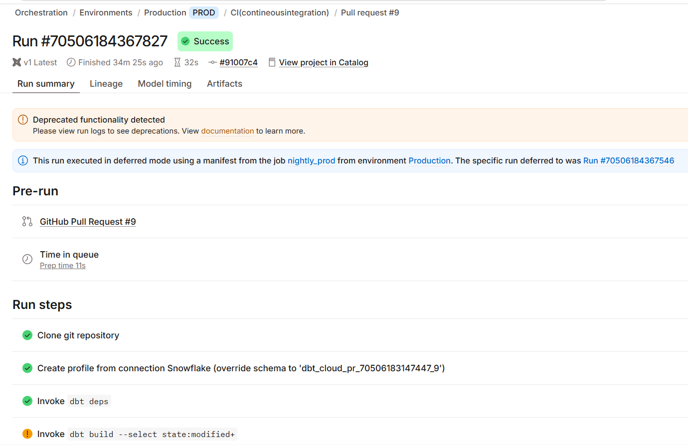
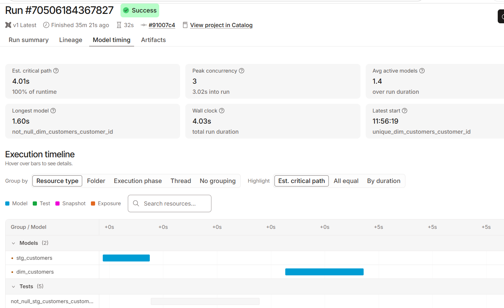
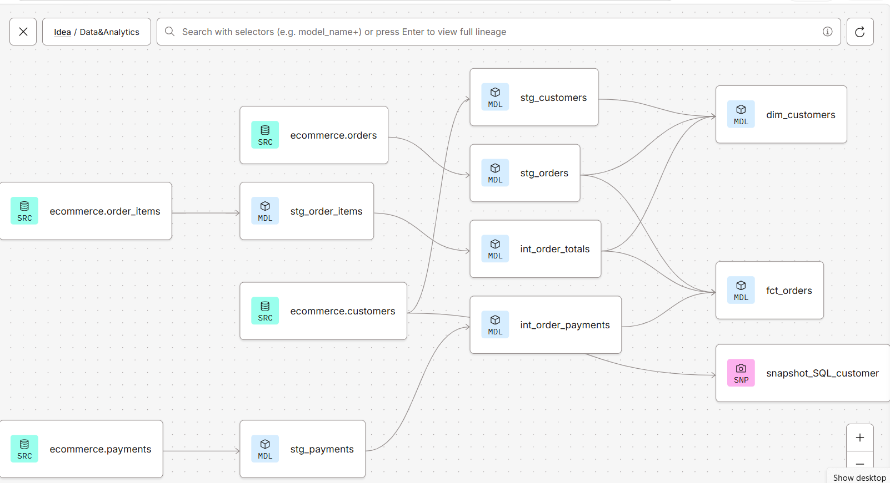
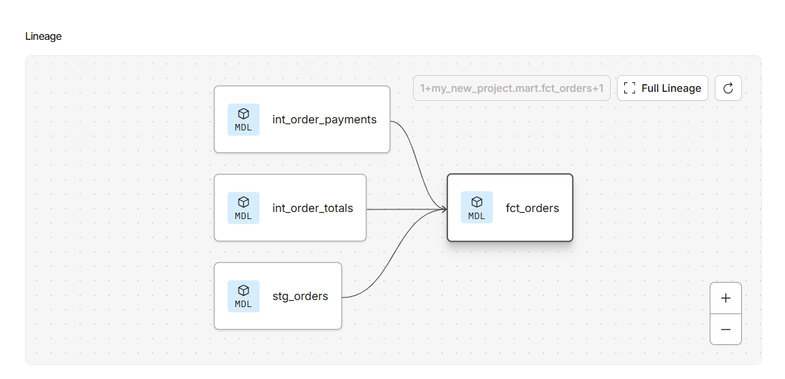

# DBT
# E-commerce Analytics with dbt Cloud and Snowflake

An end-to-end analytics engineering project. Raw e-commerce data in Snowflake is transformed with dbt Cloud into tested, documented staging, intermediate and mart models, with separate dev and production environments and CI on pull requests.

## Tech stack

- Snowflake (warehouse, roles, databases)
- dbt Cloud (IDE, environments, deploy job, CI job)
- GitHub (version control, pull requests)

## Architecture

```
RAW.ECOMMERCE (sources)
   customers, orders, order_items, payments
        |
        v
staging (views)          stg_customers, stg_orders, stg_order_items, stg_payments
        |
        v
intermediate (views)     int_order_totals, int_order_payments
        |
        v
marts (tables)           dim_customers, fct_orders (incremental)
```

| Environment | Database | Schema | Built by |
|---|---|---|---|
| Development | ANALYTICS_DEV | personal dev schema | developer in the IDE |
| Production | ANALYTICS_PROD | analytics | `nightly_prod` deploy job |
| CI (per pull request) | ANALYTICS_PROD | temporary `dbt_cloud_pr_*` schema | CI job |

## Layer rules

- **Staging:** one model per source table. Rename, cast, convert cents to dollars. No joins, no business logic.
- **Intermediate:** joins and reusable logic, each model with a clear one-row-per-key grain.
- **Marts:** business-facing models. `dim_customers` for customers, `fct_orders` for orders.

## What is implemented

- **Sources and freshness:** declared in YAML, with `loaded_at_field` and warn/error thresholds on `orders` and `payments`.
- **Tests:** `unique`, `not_null`, `accepted_values` and `relationships` on all key columns, plus a singular test that fails on negative order totals.
- **Incremental model:** `fct_orders` uses the `merge` strategy with `unique_key = order_id`, a 3 day lookback window for late-arriving rows, and `QUALIFY ROW_NUMBER()` to keep only the latest record per order.
- **Snapshot:** SCD type 2 history of customers using the timestamp strategy.
- **Macro:** `cents_to_dollars` reused across staging models.
- **Environments and jobs:** a Production environment, a `nightly_prod` job (source freshness, then build) and a slim CI job.
- **Slim CI:** on each pull request, `dbt build --select state:modified+` builds only changed models and their children, deferring unchanged upstream models to production.

## Screenshots

**CI run on a pull request** (deferred mode, temporary schema)


**CI model timing**



**Production run**



**Lineage graph**



**GitHub pull request with the dbt Cloud check**



## Design decisions and lessons learned

- **Fan-out caught by a test.** A `unique` test on `fct_orders.order_id` failed. The cause was a wrong grain in `int_order_totals`, where the `group by` split one order into several rows. I fixed the grouping at the source and added `unique` tests on the intermediate models so the problem is caught where it starts.
- **Orders without items.** Some orders have no order items, so `fct_orders` coalesces item count and total to 0 rather than leaving NULLs.
- **Aggregates in a dimension.** `dim_customers` includes lifetime order metrics for convenience. A stricter design would keep them in a separate customer metrics model.
- **Merge needs a unique key.** Duplicates in the incoming batch can cause a nondeterministic merge error on Snowflake, so the model deduplicates before the merge.
- **Snapshot limits.** A snapshot only sees the source when it runs, so several changes between runs collapse into one new version. With the timestamp strategy, a change that does not move `updated_at` is not detected.
- **Production scope.** The production job selects specific folders, so older practice models in the repo are not built in production.

## Sample data

The raw tables are generated inside Snowflake with `GENERATOR`: 1,000 customers, 10,000 orders, 25,000 order items and 10,000 payments. Payment amounts are random and do not reconcile with order totals.

## Next steps

- Move `freshness` settings under `config` to clear deprecation warnings
- Add model contracts and versions on the marts
- Add exposures for downstream dashboards
- Try the `microbatch` incremental strategy
- Add branch protection that requires the CI check
